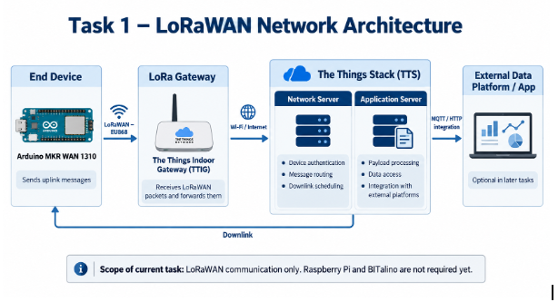
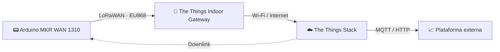

<div align="center">

# 📡 PBE · Team 1

**Projecte Bàsic d'Enginyeria** — Grau en Enginyeria de Tecnologies i Serveis de Telecomunicació (UPC)


</div>

---

## 📑 Índice

- [Descripción](#-descripción)
- [Arquitectura](#️-arquitectura)
- [Estructura del repositorio](#-estructura-del-repositorio)
- [Documentación](#-documentación)
- [Progress Reports](#-progress-reports)

## 📝 Descripción

Repositorio del equipo 1 de PBE. Aquí se recoge la documentación técnica del proyecto y los informes de progreso que se van presentando a lo largo del cuatrimestre.

## 🏗️ Arquitectura

**Task 1 — Red LoRaWAN**





Detalle de cada bloque en [`docs/arquitectura.md`](docs/arquitectura.md).

## 📂 Estructura del repositorio

```
pbe-team1/
├── Progress Reports/     # Presentaciones de seguimiento (.pptx)
├── docs/                 # Documentación técnica
│   ├── img/              # Diagramas e imágenes
│   └── arquitectura.md
└── README.md
```

## 📚 Documentación

| Documento | Contenido |
|-----------|-----------|
| [Arquitectura](docs/arquitectura.md) | Arquitectura de red LoRaWAN (Task 1) |

## 📊 Progress Reports

| Fecha | Presentación |
|-------|--------------|
| 20/10/2026 | [ProgressReport_PBE_20_10_26.pptx](Progress%20Reports/ProgressReport_PBE_20_10_26.pptx) |
| 28/10/2026 | [ProgressReport_PBE_28_10_26.pptx](Progress%20Reports/ProgressReport_PBE_28_10_26.pptx) |

Todos los informes están en la carpeta [`Progress Reports`](Progress%20Reports).
