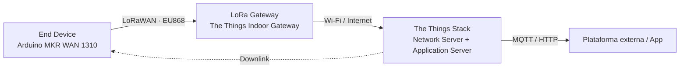

# Arquitectura del sistema

## Task 1 — Red LoRaWAN

| Bloque | Elemento | Función |
|--------|----------|---------|
| **End Device** | Arduino MKR WAN 1310 | Envía mensajes *uplink* por LoRaWAN (banda EU868) |
| **LoRa Gateway** | The Things Indoor Gateway (TTIG) | Recibe los paquetes LoRaWAN y los reenvía por Wi-Fi/Internet |
| **Network Server** | The Things Stack | Autenticación de dispositivos, enrutado de mensajes y planificación de *downlinks* |
| **Application Server** | The Things Stack | Procesado del *payload*, acceso a los datos e integración con plataformas externas |
| **Plataforma externa / App** | — | Recibe los datos vía MQTT/HTTP (opcional, en tareas posteriores) |

> **Alcance de la tarea actual:** solo comunicación LoRaWAN. La Raspberry Pi y BITalino todavía no son necesarios.

[⬅️ Volver al inicio](../README.md)
